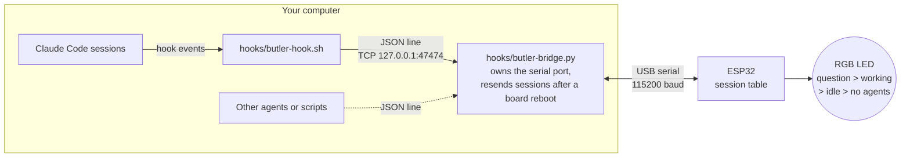

# ESP32 Butler

A light on your desk that shows what your AI coding agents are doing: **working**, **asking you something**, or **idle**.

[Claude Code](https://claude.com/claude-code) hooks report each session's state over USB to an ESP32 board plugged into your
computer, and the board's RGB LED shows the most urgent state across all your sessions. Glance at it from across the room
and you know whether Claude is waiting for you. No Wi-Fi and no cloud: it works wherever your laptop goes.



## What the light means

| LED                             | Meaning                                                                                    |
| ------------------------------- | ------------------------------------------------------------------------------------------ |
| **Amber, fast blink**           | An agent is asking you something: a question, a permission prompt, a plan to approve       |
| **Blue, breathing**             | An agent is working                                                                        |
| **Green, short blip every 2 s** | Every agent is done and waiting for your next prompt                                       |
| Dim white blip every 3 s        | No agents running                                                                          |
| Red, double blink every 2 s     | The computer hasn't talked to the board for 45 s (see [Troubleshooting](#troubleshooting)) |
| White, solid                    | Starting up (the first few seconds)                                                        |

With several sessions open, the most urgent one wins: amber over blue over green. Every state changes over time, so a light
that stays lit or dark without changing means the firmware has hung: unplug the board and plug it back in.

## What you need

- **An ESP32 board with an RGB LED (WS2812) and a USB-to-UART chip.** The reference board is the
  **ESP32-C6-DevKitC-1**, which has both on board, so there's nothing to wire. See [Other boards](#other-boards).
- **A data USB cable.** Some cables only charge; if the board never shows up as a port, try another cable.
- **macOS** (tested) or **Linux** (should work, not yet tested). Windows isn't supported.
- **[ESP-IDF v6.1](https://docs.espressif.com/projects/esp-idf/en/latest/esp32/get-started/)**, Espressif's SDK, to build
  and flash the firmware. The [EIM installer](https://docs.espressif.com/projects/idf-im-ui/en/latest/) is the easiest way.
- `jq`, `perl` and `python3` on the computer (on macOS: `brew install jq`; perl and python3 are usually already there).
- **Claude Code**, for the hooks. Other agents can report too: see [Serial API](#serial-api).

## Setup

### 1. Get the code and create your settings file

```sh
git clone git@github.com:hkar19/esp32_butler.git esp32_butler
cd esp32_butler/firmware
./bt.sh init            # creates butler.env, your local settings file (git-ignored)
```

Open `firmware/butler.env` and check section 1:

- `IDF_ACTIVATE`: where your ESP-IDF v6.1 activate script is. The default is right for an EIM install. If you already
  exported ESP-IDF in your shell (`. $IDF_PATH/export.sh`), this is ignored.
- `IDF_TARGET`: your chip. `esp32c6` for the reference board.
- `ESPPORT`: the board's serial port. See the next step.

### 2. Find the port

Plug the board in by its **UART** USB port. Boards with two USB ports (like the ESP32-C6-DevKitC-1) label them "UART" and
"USB"; use **UART**. Then list the serial ports, unplug the board, list them again, and see which one disappeared:

```sh
ls /dev/cu.*                         # macOS: usually /dev/cu.usbmodem… or /dev/cu.usbserial-… or /dev/cu.wchusbserial…
ls /dev/ttyUSB* /dev/ttyACM*         # Linux: usually /dev/ttyUSB0 or /dev/ttyACM0
```

Put that path in `ESPPORT`. On macOS the name comes from the board's USB serial number, so it stays the same whichever USB
socket you use. On Linux, add yourself to the `dialout` group (`sudo usermod -aG dialout $USER`, then log out and in) if
you get "permission denied".

### 3. Build and flash

```sh
./bt.sh build flash
```

The first build takes a few minutes. When it's done, the board restarts: the LED is white for a few seconds, then blinks red
(nothing is talking to it yet, which is expected).

### 4. Check the colours

```sh
./bt.sh led-test
```

This shows each state for 5 seconds and prints what you should see. If "idle" shows **red** instead of green, your LED takes
its colours in a different order: run `./bt.sh menuconfig`, open **Butler status LED**, untick
**The LED takes its colours in R-G-B order**, save, and `./bt.sh build flash` again.

### 5. Connect Claude Code

```sh
../hooks/install.sh
```

This adds the butler's hooks to `~/.claude/settings.json`, for every Claude Code session on this computer. It keeps a
backup at `~/.claude/settings.json.bak-butler` and leaves your other settings and hooks alone.

Start a new Claude Code session. The light turns green; send a prompt and it breathes blue while Claude works, then blinks
amber when Claude asks you something.

To remove the hooks: `../hooks/install.sh --uninstall`.

## Everyday commands

Run these from `firmware/`:

| Command                                         | What it does                                                 |
| ----------------------------------------------- | ------------------------------------------------------------ |
| `./bt.sh state`                                 | What the board shows, and every session it knows             |
| `./bt.sh clear`                                 | Forget every session (they come back on their next event)    |
| `./bt.sh log`                                   | The board's log, live, without resetting it (Ctrl+C to quit) |
| `./bt.sh led-test [--state NAME] [--seconds N]` | Check the LED states by eye                                  |
| `./bt.sh monitor`                               | ESP-IDF's serial monitor; resets the board (Ctrl+] to quit)  |
| `./bt.sh help`                                  | All commands                                                 |

| You changed                                                         | Run                                                                      |
| ------------------------------------------------------------------- | ------------------------------------------------------------------------ |
| Brightness or timeouts (`butler.env` section 2)                     | `./bt.sh provision flash-nvs` (no rebuild)                               |
| The code, `sdkconfig.defaults`, or anything in `./bt.sh menuconfig` | `./bt.sh build flash`                                                    |
| `IDF_TARGET`                                                        | `./bt.sh build flash` (it starts the build config over for the new chip) |
| `hooks/butler-bridge.py`                                            | `../hooks/install.sh` (restarts the bridge)                              |

Settings in `butler.env` section 2, all optional:

| Setting                 | Default | What it does                                                                                             |
| ----------------------- | ------- | -------------------------------------------------------------------------------------------------------- |
| `BT_LED_BRIGHTNESS_PCT` | 10      | LED brightness, 1-100. A WS2812 at full power is glaring on a desk                                       |
| `BT_WORKING_STALE_S`    | 1800    | A "working" session with no news for this long shows as idle (pressing Esc in Claude Code sends no hook) |
| `BT_SESSION_TTL_S`      | 43200   | A session with no news for this long is forgotten (a terminal closed without ending the session)         |

## Other boards

The firmware needs two things from the board:

1. **A USB port wired to a USB-to-UART chip** (CP2102, CH340, CH343, …), connected to the chip's UART0. That's where the
   firmware listens. Most DevKits have one. Tiny boards whose only USB port goes straight into the ESP32 (many "SuperMini"
   boards) won't work as they are.
2. **A WS2812 RGB LED.** Many DevKits have one on board. If yours doesn't, wire a single WS2812 (or one pixel of a strip):
   5V (or 3V3) to VCC, GND to GND, any free GPIO to DIN. **Unplug the board before wiring.**

Set `IDF_TARGET` in `butler.env`, then set the LED's GPIO with `./bt.sh menuconfig` → **Butler status LED** →
**GPIO of the WS2812 status LED**, then `./bt.sh build flash`.

| Board                          | `IDF_TARGET` | LED GPIO                      | Status                         |
| ------------------------------ | ------------ | ----------------------------- | ------------------------------ |
| ESP32-C6-DevKitC-1             | `esp32c6`    | 8 (the default)               | Tested on hardware             |
| ESP32-C3-DevKitM-1             | `esp32c3`    | 8 (the default)               | Builds; not tested on hardware |
| ESP32-S3-DevKitC-1             | `esp32s3`    | 48 on v1.0 boards, 38 on v1.1 | Not tested yet                 |
| ESP32-DevKitC (original ESP32) | `esp32`      | none on board: wire one       | Not tested yet                 |

For any other board, check its schematic for the LED's GPIO. The firmware uses a 4 MB flash layout, which fits every common
DevKit. If you get it working on another board, a pull request adding a row here is welcome.

## Troubleshooting

**The light blinks red.** Nothing on the computer has talked to the board for 45 s. Usually:

- No Claude Code session has started since you logged in. The bridge (below) starts with the first session, so start one,
  or run `./bt.sh state`.
- The computer is asleep, or `./bt.sh monitor` or a flash is using the port. It goes back to normal by itself.
- `ESPPORT` is wrong. `./bt.sh state` then says `can't open …`; see `~/.butler/bridge.log`.

**`./bt.sh state` says `no_board`.** The bridge can't open the port: the board is unplugged, `ESPPORT` is wrong, or another
program (a serial terminal, Arduino IDE) has the port open. Close it; the bridge retries every 2 seconds.

**Flashing fails with "Resource busy" or "could not open port".** Another program has the port. The bridge lets go
of it automatically during `./bt.sh flash`, but not for other tools.

**A session stays blue after I pressed Esc.** Claude Code sends no hook for Esc. The session turns green on your next prompt,
or by itself after `BT_WORKING_STALE_S` (30 min).

**The colours are wrong.** See step 4 above.

## How it works

### The bridge

Only one program can use a serial port at a time, so **`hooks/butler-bridge.py`** (Python standard library only) owns it,
and everything else talks to the bridge on `127.0.0.1:47474`. That way:

- reports from many sessions never get mixed up on the wire;
- the port is locked while the bridge has it, so nothing can write into the middle of a flash. `./bt.sh flash`, `flash-nvs`
  and `monitor` ask the bridge to let go (by writing their PID to `~/.butler/paused`), and it takes the port back when they
  exit;
- the bridge remembers each session's last state and sends them all again whenever the board restarts or is plugged back in,
  so flashing or unplugging the board loses nothing;
- it sends a `health` request every 15 s, so the board can tell when the computer has gone quiet (red).

Nobody has to start the bridge: the hook starts it if it isn't running, and it runs until you log out. If the board is
unplugged, the bridge retries every 2 seconds. Its log, including every line the board logs, is `~/.butler/bridge.log`
(`./bt.sh log`). The bridge only listens on 127.0.0.1, so only programs on your own computer can reach it.

### Claude Code hooks

[`hooks/butler-hook.sh`](hooks/butler-hook.sh) maps hook events to a state:

| Hook event                                                                                                                       | State                    |
| -------------------------------------------------------------------------------------------------------------------------------- | ------------------------ |
| `UserPromptSubmit`, `PreToolUse`, `PostToolUse`                                                                                  | working                  |
| `PreToolUse` for `AskUserQuestion` / `ExitPlanMode`, `PermissionRequest`, `Notification` (permission_prompt, elicitation_dialog) | question                 |
| `SessionStart`, `Stop`, `Notification` (idle_prompt)                                                                             | idle                     |
| `SessionEnd`                                                                                                                     | the session is forgotten |

The hook sends its report in the background, so it returns in about 0.04 s whether or not the board is there. Each session
is labelled with its project folder's name, which `./bt.sh state` shows.

Known gaps:

- **Esc** sends no hook, so an interrupted session stays "working" until the next prompt, or for `BT_WORKING_STALE_S`.
  The same timeout means a single tool running longer than that (a long build) shows as idle before it ends.
- A terminal killed without ending its session is forgotten after `BT_SESSION_TTL_S`. `./bt.sh clear` resets at once.
- Only agents on the computer the board is plugged into can report.

### Serial API

One JSON object per line, both to the bridge (TCP `127.0.0.1:47474`) and from the bridge to the board (UART, 115200 8N1).
Every request gets one answer line. Any agent or script can report, not just Claude Code:

```sh
python3 hooks/butler-bridge.py send '{"op":"state","session":"my-agent","state":"working","name":"demo"}'
# or, without Python (bash):  printf '%s\n' '{"op":"state",...}' > /dev/tcp/127.0.0.1/47474
```

| Request                                                                                            | Answer                                                                                                                                  |
| -------------------------------------------------------------------------------------------------- | --------------------------------------------------------------------------------------------------------------------------------------- |
| `{"op":"state","session":"<id>","state":"working\|question\|idle\|end","name":"<label>","t":<ms>}` | `{"ok":true,"led":"working"}`. `t` (optional) is the sender's clock in ms: a report older than the last one for that session is dropped |
| `{"op":"get"}`                                                                                     | `{"led":"working","agents":[{"session","name","state","silent_s"}]}`                                                                    |
| `{"op":"clear"}`                                                                                   | forget every session                                                                                                                    |
| `{"op":"led_test","state":"X","seconds":N}`                                                        | show one LED state for N (1–30) seconds; `"state":"off"` stops                                                                          |
| `{"op":"health"}`                                                                                  | `{"ok":true,"uptime_s":..,"fw":".."}`                                                                                                   |
| errors                                                                                             | `{"error":{"code":"..","message":".."}}`; from the bridge also `no_board` (unplugged, or paused for flashing) and `no_answer`           |

On the wire to the board, the bridge adds an `"id"` to each request; the board answers on a line starting with `@bt ` and
the same `id`, and says `@bt {"hello":true,"fw":".."}` when it boots. Every other line from the board is its log.

### Layout

| Path                                                         | What                                                                        |
| ------------------------------------------------------------ | --------------------------------------------------------------------------- |
| `firmware/main/`                                             | Starts things up and wires them together, nothing else                      |
| `firmware/components/bt_config`                              | Settings from NVS namespace `bt` (brightness, timeouts), all optional       |
| `firmware/components/bt_agents`                              | The session table: states, out-of-order reports, stale and expired sessions |
| `firmware/components/bt_led`                                 | The WS2812: board problems over the agents' state                           |
| `firmware/components/serial_api`                             | The serial API above, on the console UART, and the no-host timeout          |
| `firmware/bt.sh`, `butler.env.example`, `tools/provision.py` | Build, settings image, flash                                                |
| `hooks/`                                                     | The Claude Code hook, its installer, and the bridge                         |
| `.github/workflows/build.yml`                                | CI: the build check below and the tests, on every push and pull request     |
| `tests/`                                                     | Tests CI runs: every executable `test_*` file ([CONTRIBUTING](CONTRIBUTING.md)) |

## Checking the build

```sh
cd firmware
./bt.sh test-build                                   # ESP32-C6
./bt.sh test-build --target esp32c6 --target esp32c3 # several chips
```

This builds the firmware from scratch in a temporary folder, using only the files in the repo (not your `sdkconfig` or
`build/`), so it shows what a fresh clone gets. It fails on any compile error, any warning (ESP-IDF builds with `-Werror`),
or an app too big for its partition, and prints the compiler's error lines. It needs ESP-IDF v6.1 but no board and no
`butler.env`. Your own build is left alone.

GitHub Actions runs the same check for ESP32-C6 on every push and pull request, in Espressif's `espressif/idf:v6.1`
Docker image, then every test in `tests/`. Please run it before opening a pull request; see [CONTRIBUTING](CONTRIBUTING.md).

## Contributing

Fork, branch, and open a pull request to `main`. New features need a test. Details in [CONTRIBUTING.md](CONTRIBUTING.md).

## License

[MIT](LICENSE)
